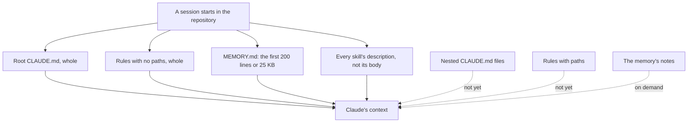
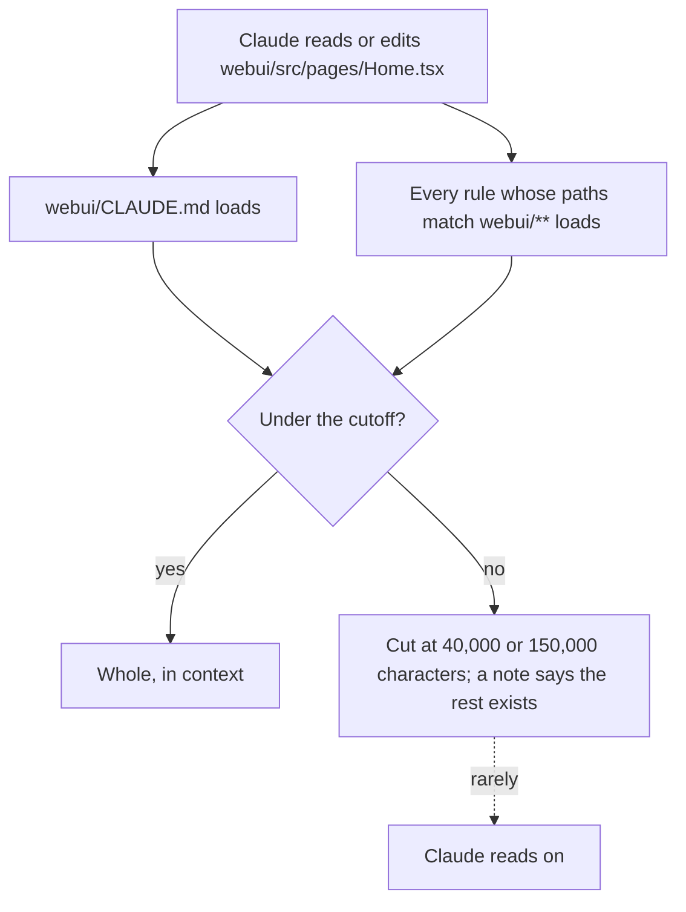
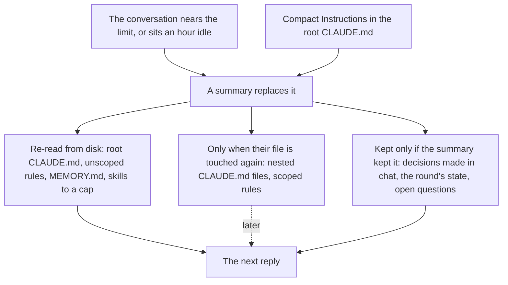
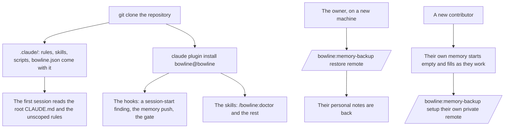
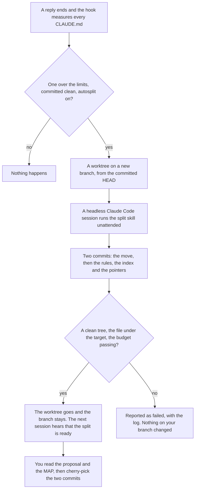

# The guide: why bowline exists, and how it thinks

This page is for someone who has used Claude Code for a month, keeps a `CLAUDE.md`, and wonders why it seems to be
ignored more as it grows. It gives the problem in a page, the three homes knowledge can live in, the budgets and where
their numbers come from, and the four flows that decide what Claude actually has in front of it at any moment. The
facts with their sources are in [facts.md](facts.md); the conventions in [conventions.md](conventions.md); the
migration in [migrating.md](migrating.md).

## The problem, in a page

Claude Code reads your repository's instructions in three different ways, and only one of them is "whole, always".

The root `CLAUDE.md` is read whole at the start of every session and again after every compaction. Everything in it
costs context on every turn, so it should be short; the documentation's target is 200 lines, and it warns above that.

A `CLAUDE.md` in a subfolder, and a rules file scoped to paths, load on demand, when a file under that folder is read or
edited. They are cut at a fixed size: 40,000 characters on a 200K context window, 150,000 on a 1M window. Past the cut,
Claude gets a note that it may read the rest with the Read tool, and in practice it does not. A repository whose web
UI conventions have grown to 465 KB in one file is applying the first third of them, and nothing says so. That was the
real number in the repository bowline came from, and the sections past the cut held the owner's own visual standards for
the product.

The memory Claude keeps about your project is a folder per person per machine, outside the repository. At a session's
start only its index loads, and only the first 200 lines or 25 KB of it; the notes are read on demand. Nothing backs
the folder up; a reinstalled machine loses months of it. And it is personal by design: a checked-in setting cannot point
a team at one shared folder, so what a project needs every contributor to know cannot live there.

A long conversation is summarized when the context fills, and after about an hour of quiet. Without a section telling
the summary what to keep, the state of the work is kept or lost at the summary's discretion.

None of this is hidden; it is spread over six documentation pages, and nobody measures their own repository against it.
bowline measures, and says what to do.

## Three homes, by kind

The fix is not to write less. It is to put each kind of knowledge where the tool loads it.

| Kind | What it is | Where it lives | When Claude has it |
|---|---|---|---|
| A rule | An imperative with its one-sentence why: "do this, because". | `.claude/rules/<area>/*.md`, with a `paths:` list | Whole, whenever a file in its area is touched |
| A procedure | How to run the checks, do a live check, push a round. | `.claude/skills/<name>/SKILL.md` | Its description always; its body only when used |
| A decision or a story | Why something is the way it is; what was tried; the history. | `docs/`: a decisions section, the roadmap, `docs/conventions/` for the long form of the rules | On demand, when someone asks why |
| The standing rules | What every session must know: how to write for a person, where decisions are recorded, what a summary must keep, what the memory is for. | The root `CLAUDE.md`, under 200 lines | Whole, every session |
| An index | What a part of the code is, and where its rules, skills and pages are. | A nested `CLAUDE.md`, under 200 lines | Whole, when a file in that part is touched |

The budgets follow from the cuts: every `CLAUDE.md` under 200 lines; every rules file under 200 lines and 40,000
characters, so it loads whole for everyone; the scoped rules of one area under 40,000 characters together, about
10,000 tokens, the price of touching a file there; the rules every session loads under 10,000 characters, because
those are the most expensive per character. `bowline budget` checks these, `bowline doctor` explains each finding, and
`defaults.json` carries every number with its reason, laid over by a repository's `.claude/bowline.json`.

## The five flows

### What loads when a session starts

The root file and the unscoped rules are the whole standing knowledge. Everything else waits for a reason.

### What loads when a file is touched

This is why a nested `CLAUDE.md` becomes an index and the rules move into files that are each under the cut: the same
knowledge, loaded whole instead of cut.

### What survives a compaction

The state of the work survives a compaction only if it was written down before it: in the roadmap, a progress note, or
the memory. The Compact Instructions section tells the summary to keep exactly that, and the convention of writing the
state before a round closes makes sure there is something to keep.

### A new machine, a new contributor

The repository carries everything the project needs every contributor to know. The memory carries what is personal,
and each person's goes to that person's private remote. Nothing personal is ever shared by copying a memory; what the
project needs is promoted into the repository, written for a contributor, by `/bowline:curate-memory`.

### When a CLAUDE.md outgrows its limit, with autosplit on

Autocompact is the one thing Claude Code does to your work unasked, and it can, because a conversation's context is
nobody else's input. A `CLAUDE.md` is every future session's input, so autosplit borrows the trigger, a limit crossed
and noticed by the hook that already runs after every reply, but not the silence: the whole split happens while you
work, on a branch of its own, and the one step left to you is the merge. A repository that wants the autocompact feel
to the end sets `deliver` to `merge`, and the worker takes the two commits onto your branch itself when your tree is
clean, and the doctor says what landed until you acknowledge it. Autosplit is off until a repository turns it on in
`.claude/bowline.json`, and the doctor says at every stage what is happening and why.

## A folder of repositories

Claude Code can be started in a folder that is not a repository but holds several, as with services cloned side by
side. Its documentation says how such a session loads: the folder's own `CLAUDE.md` loads whole at the start; each
repository's `CLAUDE.md`, and the rules under its `.claude/rules/`, load on demand, when a file under that repository is
read or edited; and the memory is one folder for the whole workspace, keyed on the folder, because "outside a git repo,
the project root is used instead". bowline follows the same shape. The doctor, the budget, the one-line finding at a
session's start and the reminders measure the folder's own `CLAUDE.md` and every repository directly under it, and name
the repository in each finding. The gate finds the repository a commit names. Autosplit works per repository, each
split on a branch of its own repository, and a `.claude/bowline.json` in the folder is the layer every repository
shares, under its own. From the folder, `init` writes the folder's own `CLAUDE.md`, an index of the repositories with
the sections every root file needs, and the shared `.claude/bowline.json`; `init --each` scaffolds every repository.
`move` and `autosplit` take the repository from the file they are given, as a path from the folder; the few commands
that take no file want `--repo`. The skills say the same, so Claude needs no reminding.

The folder decides whether bowline writes into its repositories at all. With `"writeToRepositories": false` in the
folder's `.claude/bowline.json`, for repositories you cannot or would rather not write into, every file bowline writes
stays in the folder: a rule for one repository goes in the folder's `.claude/rules/<repository>/`, scoped with
`paths: ["<repository>/**"]`, because the documentation says a rule's patterns are relative to "the directory that
contains the rule's .claude folder". `init --each`, `move` and autosplit then write nothing into the repositories, and
the doctor measures them in notes that say why. Such files serve sessions started in the folder: a session started
inside a repository reads the folder's `CLAUDE.md`, but Claude Code looks for skills only "up to the repository root".
The folder can also be a git repository of its own, which holds what its repositories share without tracking them,
so that its files are versioned like any repository's.

## What bowline does, and what it leaves to you

The mechanics are automatic: the memory push after every reply, the gate before a commit, the one-line finding at a
session's start when something is over budget or unbacked, and one reminder during a session when something crosses
a limit, said once and heard by Claude at your next message. Every change to your knowledge is a skill you or Claude
invoke, with a plan you approve before anything moves: scaffolding the layout, sorting the memory, splitting a file,
adopting a convention. A tool that rewrote the rules you work from in the background would be the one thing bowline
exists to prevent, and autosplit keeps to that: it prepares the split of an oversized `CLAUDE.md` while you work, on a
branch of its own, and leaves the merge to you.

## Where to start

1. `claude plugin marketplace add taljacob2/bowline` and `claude plugin install bowline@bowline`.
2. In a repository, `/bowline:doctor`. Read the report; each finding names the skill that fixes it.
3. `/bowline:init` for the layout, `/bowline:memory-backup` for the backup, and `/bowline:split-instructions` when a
   `CLAUDE.md` is over the line. `/bowline:conventions` when decisions keep getting lost.
